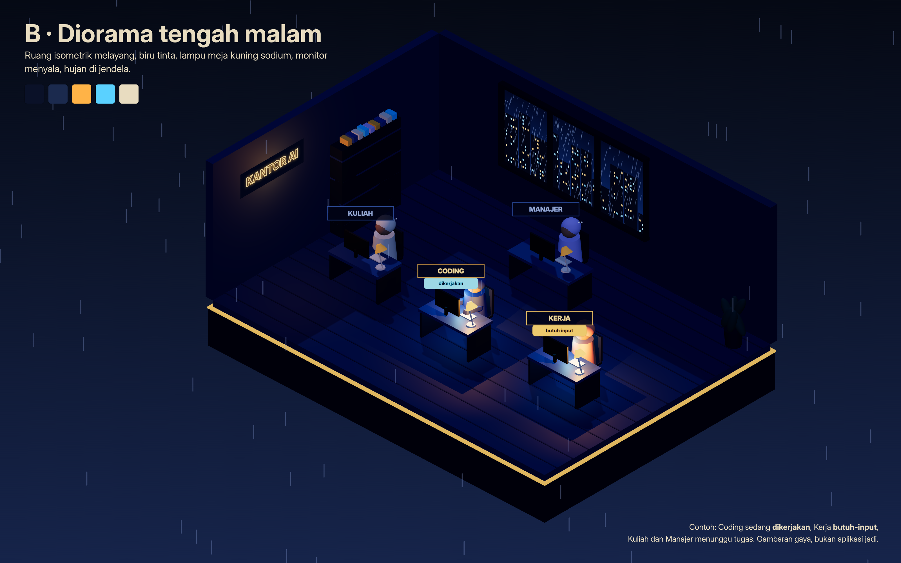

# Kantor AI Tahap 2 — Rencana Kantor 3D

Tanggal: 27 November 2026
Status: rencana, menunggu persetujuan Syahrial sebelum kode dibangun
Spec induk: `docs/2026-11-27-kantor-ai-design.md` bagian 9

**Goal:** Halaman kantor 3D di `kantor/` yang membaca `karyawan.json` dan `laporan/`, lalu menampilkan siapa sedang bekerja hari ini, laporan tiap karyawan, dan timelapse satu hari. Halaman dibuka online lewat GitHub Pages.

**Prinsip yang tetap berlaku:** agennya dulu, kantornya belakangan. Kantor 3D hanya menampilkan apa yang ada di laporan. Kalau tidak ada laporan, kantornya sepi, dan itu benar.

## 1. Keputusan Syahrial (27 Nov 2026)

| Pertanyaan | Pilihan | Akibat |
|---|---|---|
| Cara membuka online | **GitHub Pages** | Repo `kantor-ai` harus jadi publik (Pages gratis tidak melayani repo privat). Lihat bagian 3. |
| Gaya tampilan | **B, Diorama tengah malam** | Lihat bagian 4 dan contoh render `docs/img/kantor-3d-gaya-b.png`. |



Contoh di atas dirender dengan Three.js dari `docs/img/kantor-3d-contoh-gaya.html` (`?g=b`). Ini gambaran gaya, bukan aplikasi jadi.

## 2. Arsitektur

```
push ke main (laporan baru / perubahan kantor)
        │
        ▼
GitHub Actions "pages"
  1. python tools/cek_laporan.py         ← laporan rusak = tidak deploy
  2. python tools/bangun_data.py         ← gabung karyawan.json + laporan/ → _site/data.json
  3. salin kantor/ → _site/
  4. actions/deploy-pages
        │
        ▼
https://diasss-msy.github.io/kantor-ai/
  index.html  ── import ──► vendor/three.module.min.js (r160, disimpan di repo)
      │                     app.js (adegan), status.js (logika), panel.js (UI)
      └── fetch("data.json")
```

- **Kenapa ada `data.json`:** halaman statis tidak bisa membaca isi folder `laporan/`. Membaca lewat API GitHub dibatasi 60 permintaan per jam tanpa login. Jadi Actions membuat satu file gabungan setiap kali ada push.
- **Kenapa Three.js disimpan di repo:** tidak bergantung pada CDN, versinya terkunci, dan halaman tetap jalan kalau CDN bermasalah.
- **Tanpa build tool:** HTML, CSS, dan modul ES biasa. Tidak ada npm di repo ini, supaya tetap sesederhana tahap 1.
- **Jeda pembaruan:** laporan baru tampil sekitar 1 sampai 2 menit setelah di-commit (waktu Actions dan cache Pages). Halaman memuat ulang `data.json` setiap 60 detik.

### Bentuk `data.json`

```json
{
  "dibuat": "2026-11-27T12:50:00+07:00",
  "karyawan": [ { "id": "coding", "nama": "Coding", "departemen": "Coding", "tugas": "…", "jam_kerja": "08:00–16:00" } ],
  "laporan": [ { "file": "laporan/2026-11-27/121127-coding-login-kasir-html.json", "waktu": "…", "agen": "coding", "tugas": "…", "dipesan_oleh": "kerja", "status": "selesai", "ringkasan": "…", "hasil": ["…"] } ]
}
```

Laporan diurutkan menurut `waktu`. Field `file` ditambahkan supaya panel bisa menautkan ke file aslinya di GitHub.

## 3. Membuat repo publik (langkah Syahrial, butuh konfirmasi)

Ini satu-satunya langkah yang tidak bisa ditarik kembali sepenuhnya: begitu publik, isi repo dan **seluruh riwayat commit** bisa dibaca dan disalin orang lain, walaupun repo dijadikan privat lagi.

Yang akan ikut publik (sudah dicek 27 Nov):

- Nama lengkap dan NIM di `instruksi-proyek.md`, `docs/2026-11-27-kantor-ai-design.md`, dan `tests/test_instruksi.py`.
- Semua laporan, termasuk path lokal Mac (`/Applications/XAMPP/xamppfiles/htdocs/laravel/perpustakaan`) dan nama repo privat `diasss-msy/perpustakaan` (isi repo itu tetap privat).
- `demo/login-kasir/` (PR #1).
- Tidak ditemukan password, token, atau isi `.env` di repo. Pencarian diulang tepat sebelum repo dijadikan publik.

Mulai saat itu, aturan tambahan untuk semua thread: **laporan tidak boleh berisi rahasia, kredensial, atau data pribadi orang lain**, karena laporan langsung publik. Aturan ini ditambahkan ke `CLAUDE.md` dan `instruksi-proyek.md` di Task 1.

Langkah **[Syahrial]**: GitHub → `kantor-ai` → Settings → General → Danger Zone → Change visibility → Public. Lalu Settings → Pages → Source: **GitHub Actions**.

Alternatif kalau nanti ingin repo tetap privat: GitHub Pro (berbayar) mengizinkan Pages dari repo privat, tetapi situsnya tetap publik. Laporan tetap terbaca orang lain di kedua cara.

## 4. Gaya B: diorama tengah malam

| Unsur | Isi |
|---|---|
| Kamera | Ortografis isometrik, ruangan melayang di tengah layar. Bisa diputar terbatas (±35°) dan di-zoom, tidak bisa masuk ke dalam. |
| Palet | Latar `#0a1128` → `#16244a`, dinding `#1b2a4e`, aksen sodium `#ffb347`, layar `#5ad1ff`, teks `#e8dcc0`. |
| Cahaya | Cahaya bulan biru lemah dari jendela, lampu meja sodium hanya menyala di meja yang aktif, layar monitor jadi sumber cahaya biru. |
| Ruangan | Lempeng melayang dengan tepi emas, lantai papan kayu gelap, jendela besar dengan kota dan hujan (animasi), rak buku, tulisan neon "KANTOR AI", tanaman. |
| Meja | Satu per karyawan di `karyawan.json`: Manajer di belakang, Kuliah, Coding, Kerja di depan. Karyawan baru di `karyawan.json` otomatis dapat meja di baris berikutnya. |
| Karakter | Figur berhoodie low-poly, warna per departemen. Perbaikan dari contoh: diberi cahaya tepi (rim light) supaya karakter yang diam tetap terlihat. |
| Huruf | Inter Display untuk label dan panel. |

### Status di ruangan

Status setiap karyawan diambil dari **laporan terakhirnya pada hari yang dilihat** (WIB).

| Status laporan terakhir | Tampilan |
|---|---|
| tidak ada laporan hari itu | Lampu mati, layar redup, "z z" melayang |
| `dikerjakan` | Lampu sodium dan layar menyala, karakter mengetik (animasi lengan), label biru "dikerjakan" |
| `butuh-input` | Lampu berkedip pelan oranye, tanda "?" di atas kepala, label oranye |
| `gagal` | Layar merah berkedip, label merah "gagal" |
| `selesai` | Lampu menyala redup, tanda centang singkat lalu kembali tenang |

### Interaksi

- **Klik karakter atau meja:** panel samping (di HP: lembar dari bawah) berisi laporan karyawan itu pada hari yang dilihat, terbaru di atas: jam, tugas, status, ringkasan, pemesan, dan `hasil` sebagai tautan kalau berupa URL. Tautan "lihat file" ke laporan aslinya di GitHub.
- **Pemilih tanggal:** default hari ini (WIB). Hanya tanggal yang punya laporan bisa dipilih.
- **Timelapse:** tombol putar dan slider 00:00 sampai 23:59. Saat diputar, status tiap meja berubah mengikuti waktu laporan. Satu hari diputar dalam sekitar 20 detik.
- **Papan ringkas** di pojok: jumlah laporan hari itu per status.
- Bisa dipakai di HP: sentuh untuk memilih, cubit untuk zoom.

## 5. Task

Setiap task dikirim sebagai PR ke `main`, kecuali disebut lain.

**Task 1 — Aturan laporan publik.** Tambah aturan "laporan tidak boleh berisi rahasia atau data pribadi orang lain" di `CLAUDE.md` dan `instruksi-proyek.md`. Tes `test_instruksi.py` tetap lulus (batas 16.000 karakter).

**Task 2 — `tools/bangun_data.py`.** Pustaka standar saja. Membaca `karyawan.json` dan semua laporan valid, menulis `data.json`. Tes pytest: urutan waktu, field `file`, folder kosong, laporan tidak valid membuat skrip gagal.

**Task 3 — Kerangka `kantor/`.** `index.html`, `style.css`, `vendor/three.module.min.js` (r160, beserta file lisensinya), `status.js` (fungsi murni: status per karyawan pada tanggal dan jam tertentu). Tes `status.js` dengan `node --test` di CI.

**Task 4 — Adegan gaya B.** `app.js`: ruangan, meja dinamis dari `karyawan.json`, karakter, lampu, hujan, neon, tampilan per status. Uji dengan screenshot Playwright di sandbox, lampirkan ke PR.

**Task 5 — Panel, tanggal, timelapse.** `panel.js` dan kontrolnya, termasuk tata letak HP (lebar 390 px).

**Task 6 — Deploy.** Workflow `.github/workflows/pages.yml`: cek laporan, bangun data, deploy Pages, berjalan di setiap push ke `main`. Workflow `cek.yml` yang lama tetap ada.

**Task 7 — Buka publik [Syahrial] dan uji coba.** Setelah Task 1 sampai 6 merge: cek ulang isi repo, Syahrial mengubah repo jadi publik dan menyalakan Pages, lalu satu thread menulis laporan baru dan dicek muncul di kantor dalam ±2 menit, di laptop dan HP.

## 6. Tes dan bukti selesai

- `python -m pytest -q` dan `python tools/cek_laporan.py` lulus.
- `node --test kantor/` lulus.
- Screenshot desktop dan HP untuk setiap status dilampirkan di PR Task 4 dan 5.
- URL Pages terbuka dan menampilkan laporan hari itu.

## 7. Bukan bagian tahap 2

- Agen yang bekerja sendiri sesuai jadwal.
- Login atau halaman privat.
- Mengubah format laporan. Kantor menyesuaikan diri dengan format tahap 1.
- Suara, avatar wajah, atau model 3D dari luar. Semua bentuk dibuat dari geometri sederhana di kode.

## 8. Masih terbuka

- **Nama karyawan.** Saat ini nama sama dengan departemen ("Coding"). Kalau Syahrial ingin nama seperti "Pak Budi", cukup ubah `nama` di `karyawan.json`; kantor menampilkannya otomatis.
- **Kapan repo dibuka publik.** Menunggu Task 1 sampai 6 merge dan konfirmasi Syahrial di Task 7.
